<div align="center">


# Our Store

**A bilingual (Arabic / English) e-commerce app with a full admin console, built with Flutter, Supabase and Firebase.**

[](https://flutter.dev)
[](https://supabase.com)
[](https://firebase.google.com)
[](#platform-notes)

### [Live demo](https://our-store-shop.web.app)

[https://our-store-shop.web.app](https://our-store-shop.web.app)

</div>

---

## Table of contents

1. [Overview](#overview)
2. [Screenshots](#screenshots)
3. [Features](#features)
4. [Architecture](#architecture)
5. [Tech stack](#tech-stack)
6. [Project structure](#project-structure)
7. [Database](#database)
8. [Security model](#security-model)
9. [Push notifications](#push-notifications)
10. [Edge Functions](#edge-functions)
11. [Setup guide](#setup-guide)
12. [Build and deploy](#build-and-deploy)
13. [Troubleshooting](#troubleshooting)
14. [Platform notes](#platform-notes)
15. [Roadmap](#roadmap)
16. [Acknowledgements](#acknowledgements)
17. [License](#license)

---

## Overview

Our Store is a complete single-store shopping experience:

- **Customers** browse products, search and filter, save favorites, build a cart, check out with a delivery location picked on a map, track their orders, leave reviews after delivery, and receive push notifications.
- **The store owner (admin)** manages everything from inside the same app: products with images and video, banners, orders, reviews, pricing, filter options, store content and contact links, with a statistics dashboard on top.

The app is fully bilingual with right-to-left support, ships with light, dark and system themes, and runs on Android, iOS and the web from a single Flutter codebase.

> This repository is a showcase and a setup guide. It documents how the system is built and how to reproduce the backend. The application source code is kept private.

**Built in one week**, from 28 September to 4 October 2026.

---

## Screenshots

| Home | Search | Filters |
|:---:|:---:|:---:|
| 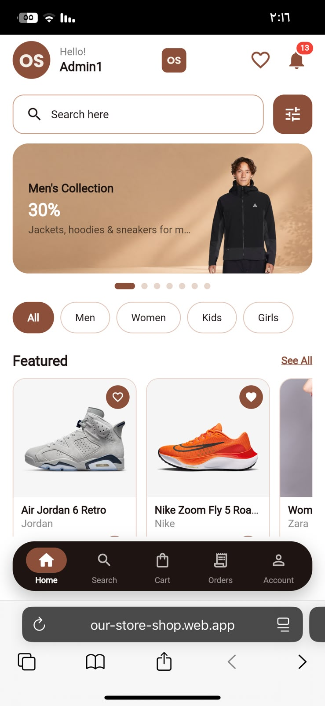 | 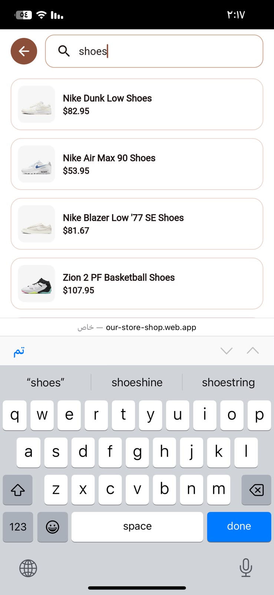 | 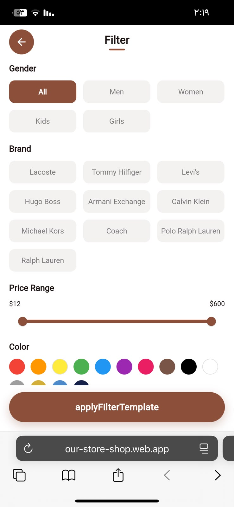 |

| Favorites | Cart | My orders |
|:---:|:---:|:---:|
| 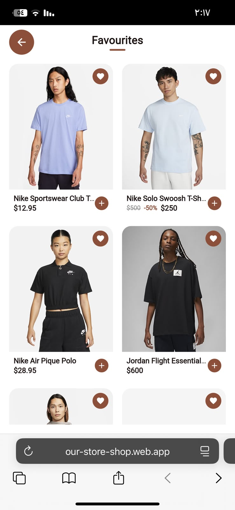 | 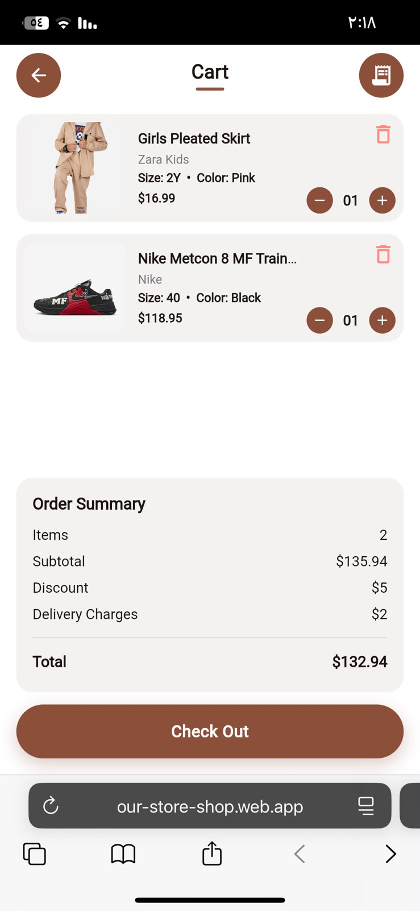 | 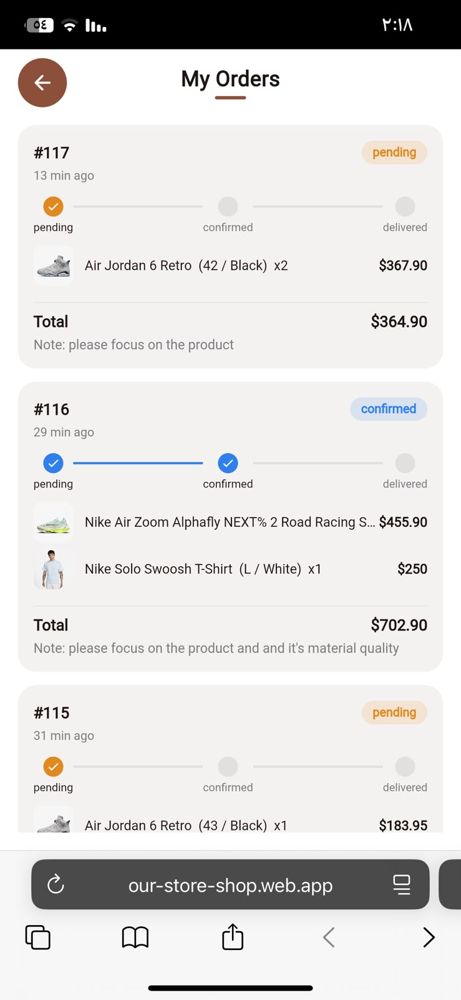 |

| Notifications | Admin | Settings |
|:---:|:---:|:---:|
| 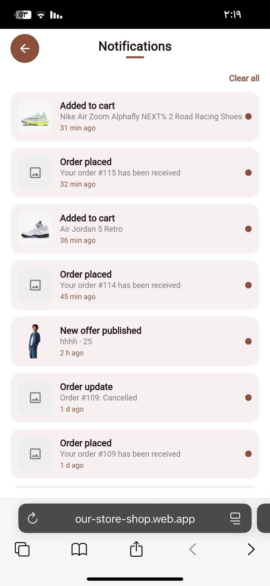 | 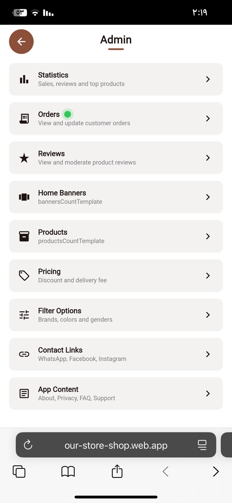 | 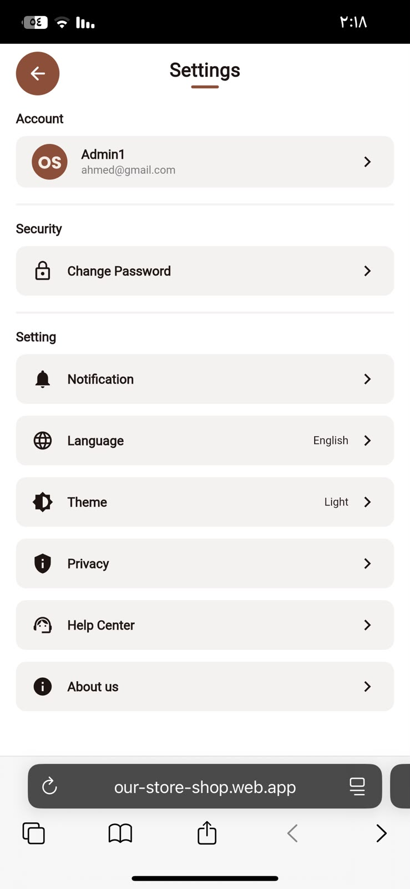 |

| Language | Dark theme |
|:---:|:---:|
| 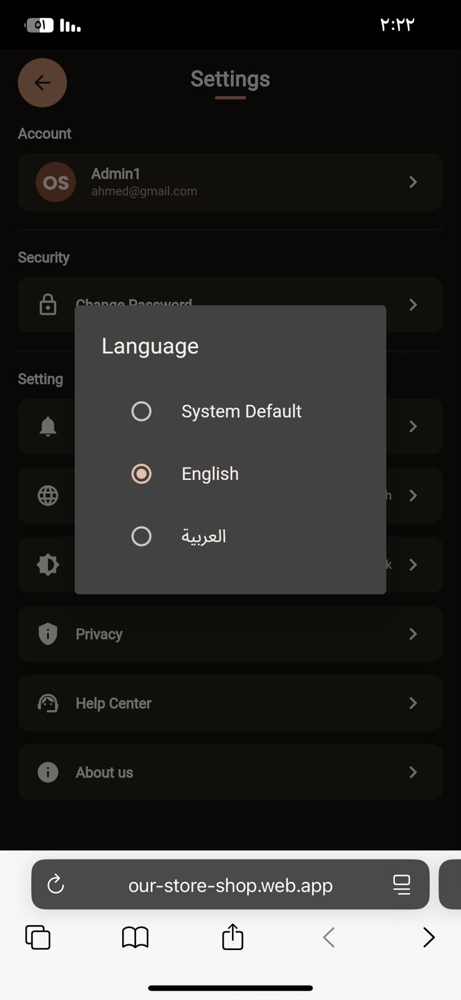 | 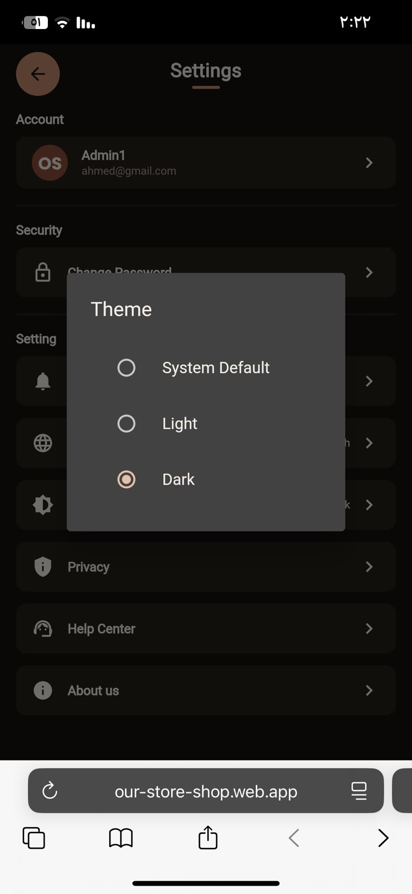 |

### Demo videos

**1. Customer order flow**

[Watch the video](videos/customer-order-flow.mp4)

The customer browses products, adds them to the cart, picks a delivery location on the map and places the order.

**2. Admin updates the order status**

[Watch the video](videos/admin-updates-order-status.mp4)

The admin opens the order, reviews its details and changes its status. The customer is notified automatically in their own language.

---

## Features

### Customer experience

**Account**
- Sign up and sign in with email and password, or with Google
- Password reset with a one-time code sent by email
- Branded splash with an animated logo reveal, followed by a four-scene onboarding

**Discovery**
- Home page with a discount banner carousel, category chips and curated product sections
- Search with typo tolerance (fuzzy matching on product name and brand)
- Arabic search terms are translated automatically, so Arabic queries also find English product names
- Filter page for brand, color, gender and price
- Favorites list

**Product page**
- Image gallery and video in one carousel, with a full-screen viewer
- Size and color selection
- Original price and discounted price shown together
- Ratings and written reviews
- Reviews can only be submitted after the order has been delivered

**Cart and checkout**
- Persistent cart synced to the account
- Order summary with discount and delivery fee
- Delivery location picked on an interactive map, with GPS positioning and address lookup
- Prices are always calculated on the server, never trusted from the device

**Orders**
- Order history with a status timeline
- Orders can be edited (phone, address, note, location) while they are still pending
- Order numbers generated by the database

**Notifications**
- Push notifications on mobile and an in-app notification center
- Delivered in the user's own language (Arabic or English)
- Per-user preferences for offers and new-product alerts

**Profile and settings**
- Edit profile, change password
- Language switch (Arabic / English) with full RTL layout
- Light, dark or system theme
- Help, about, privacy policy and contact pages, all managed by the admin
- Share the app with friends

### Admin console

**Catalog**
- Create, edit and delete products with multiple images, video, sizes, colors, brand, gender and description
- Product flags for featured, popular and sold
- Image cropping before upload
- Banner management with optional automatic background removal

**Orders and reviews**
- View every order with its items, customer details and map location
- Change order status (pending, confirmed, delivered, cancelled), which notifies the customer automatically
- New-order indicator for orders that have not been opened yet
- Moderate and delete reviews

**Store settings**
- Global discount amount and delivery fee
- Store currency chosen from 31 currencies
- Filter options for brands, colors and genders
- About us, privacy policy, FAQs, support phone and email
- WhatsApp, Facebook and Instagram links

**Statistics**
- Revenue over week, month, year or all time, compared with the previous period
- Orders broken down by status, each one drillable to the underlying orders
- Best-selling products by units and revenue
- Review statistics and rating breakdown
- Total registered users

### Engineering details

- Feature-first architecture with a shared core layer
- Full Arabic and English string tables, plus a reusable design system (Lux) for colors, text, buttons, fields and transitions
- Skeleton loaders with shimmer instead of spinners
- Subtle motion: fade and slide-in, press-scale feedback, page transitions
- Centralized error mapping that turns backend errors into friendly messages
- A single codebase for Android, iOS and the web

---

## Architecture

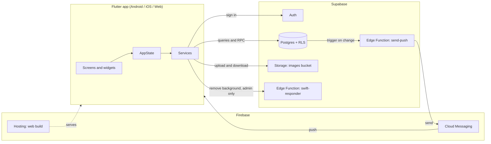

**How an order flows**

1. The customer taps **Place order**. The app calls the database function `place_order`.
2. The function reads prices from the `products` table, applies the store discount and delivery fee, writes the order and its items, and empties the cart, all in one step.
3. A database trigger notifies the `send-push` Edge Function.
4. The Edge Function sends a push notification to every admin device.
5. When the admin changes the order status, another trigger fires and the customer gets a notification in their own language.

---

## Tech stack

| Layer | Technology |
|---|---|
| App framework | Flutter and Dart |
| State management | `ChangeNotifier` based `AppState` |
| Backend | Supabase: Postgres, Auth, Storage, Edge Functions |
| Push notifications | Firebase Cloud Messaging and local notifications |
| Web hosting | Firebase Hosting |
| Authentication | Email and password, Google Sign-In |
| Maps and location | `flutter_map` with OpenStreetMap tiles, `geolocator`, `geocoding` |
| Media | `image_picker`, `image_cropper`, `video_player`, `get_thumbnail_video`, `image` |
| Sharing and links | `share_plus`, `url_launcher` |
| Persistence | `shared_preferences` |
| Localization | `flutter_localizations` with custom Arabic and English tables |
| Edge Function runtime | Deno and TypeScript |

---

## Project structure

```
our_store/
├── lib/
│   ├── main.dart                 App bootstrap only
│   ├── app.dart                  MaterialApp: theme, localization, root page
│   │
│   ├── core/                     Shared by every feature
│   │   ├── config/               Environment config and Firebase options
│   │   ├── constants/            Currencies and countries
│   │   ├── localization/         Arabic / English controller and string tables
│   │   ├── models/               Product, cart item, review, notification, banner...
│   │   ├── services/             Supabase, notifications, background removal, error mapping
│   │   ├── state/                AppState
│   │   ├── theme/                Colors, theme controller, Lux design tokens
│   │   ├── utils/                Formatters, validators, dialogs, media picker
│   │   └── widgets/              Buttons, skeletons, forms, motion, Lux components
│   │
│   └── features/                 One folder per product feature
│       ├── shell/                Root page and navigation
│       ├── intro/                Splash and onboarding
│       ├── auth/                 Login, sign up, forgot password
│       ├── home/                 Home view, banners, categories
│       ├── search/               Search and filters
│       ├── products/             Product details, media, reviews
│       ├── favorites/            Favorites
│       ├── cart/                 Cart and checkout
│       ├── orders/               My orders, details, timeline, edit order
│       ├── notifications/        Notification center
│       ├── profile/              Profile, settings, help, privacy, contact
│       ├── location/             Map picker and location services
│       └── admin/                Admin console (+ stats)
│
├── supabase/
│   ├── supabase_full_schema.sql  Tables, functions, triggers, RLS policies
│   ├── 02_auth_storage.sql       Signup trigger, images bucket, storage policies
│   ├── 03_seed.sql               Default store settings row
│   └── functions/
│       ├── send-push/            Push notification Edge Function
│       └── swift-responder/      Background removal Edge Function
│
├── assets/                       Logo, banner background, onboarding images
├── docs/                         Architecture notes and screenshots
├── env.example.json              Template for local configuration
├── firebase.json                 Firebase Hosting configuration
└── README.md
```

**Architecture rules**

- `features/*` may import from `core/*`.
- `core/*` never imports from `features/*`.
- Each file holds one screen or one widget.
- Anything shared by more than one feature lives in `core/`.

---

## Database

### Tables

| Table | Purpose |
|---|---|
| `profiles` | User profile, role flag, language and notification preferences |
| `products` | Catalog: name, brand, price, discount price, sizes, colors, media, rating, flags |
| `banners` | Home page banners with title, discount text and image |
| `app_settings` | Single row: store links, content, FAQs, discount, delivery fee, currency, filter options |
| `favorites` | Customer favorites |
| `cart_items` | Persistent cart with quantity and size |
| `orders` | Order header: status, totals, contact details, location, order number |
| `order_items` | Snapshot of each purchased product at the time of purchase |
| `order_status_log` | Audit trail of every status change and who made it |
| `product_reviews` | Ratings from 1 to 5 with optional text |
| `notifications` | In-app notification history |
| `device_tokens` | Push tokens with the language of each device |

### Database functions

| Function | What it does |
|---|---|
| `place_order` | Creates an order atomically with server-side pricing |
| `update_my_order` | Lets a customer edit their own order while it is pending |
| `review_status` | Tells the app whether the current user may review a product |
| `search_products_fuzzy` | Typo-tolerant search using trigram similarity |
| `register_device_token` / `unregister_device_token` | Manage push tokens |
| `mark_order_seen` | Marks an order as opened by the admin |
| `is_admin` | Used by policies and Edge Functions to check the caller |
| `handle_new_user` | Creates a profile row for every new account |

### Triggers

- Create a profile when a user signs up
- Block changes to the admin flag from the client side
- Recalculate a product's average rating and review count when reviews change
- Log every order status change
- Prevent deleting delivered orders
- Call the push Edge Function when relevant rows change

---

## Security model

- **Row Level Security** is enabled on every table. Customers can only read and change their own cart, favorites, orders and notifications.
- **Server-side pricing.** `place_order` ignores any price sent by the app and reads prices from the database.
- **Admin protection.** The admin flag cannot be changed from the client. The admin account is promoted manually from the Supabase dashboard.
- **Admin-only operations.** Writing products, banners and settings is allowed only when `is_admin()` is true. The background removal Edge Function also checks that the caller is an admin.
- **Reviews after delivery.** A review policy only accepts reviews from users who received the product.
- **No secrets in the client.** The app only contains the Supabase publishable key and the Google web client ID. The Firebase service account, the webhook secret and the remove.bg key live in Supabase Edge Function secrets.
- **Git hygiene.** `env.json`, Firebase options, `google-services.json`, keystores and service account files are all ignored by Git.

---

## Push notifications

Notifications are driven entirely by the database, so the app never needs to send them itself.

| Event | Who receives it |
|---|---|
| New product added | Customers who enabled new-product alerts, and admins |
| Discount added to an existing product | Customers who enabled offers, and admins |
| Banner created, or its title or discount changed | Customers who enabled offers, and admins |
| Store-wide discount changed | Customers who enabled offers, and admins |
| New order placed | Admins only |
| Order status changed | The customer who owns the order |

How it works:

1. A Postgres trigger posts the changed row to the `send-push` Edge Function, together with a shared secret header.
2. The function decides the audience, builds the message in Arabic or English for each device, and stores it in the in-app notification center.
3. It authenticates against Firebase with a service account and sends through FCM in batches of 100 devices.
4. Tokens that FCM reports as invalid are deleted automatically.

---

## Edge Functions

### `send-push`
Receives database change events, decides who should be notified, localizes the text, writes to the notification table and sends through Firebase Cloud Messaging.

Secrets: `FIREBASE_SERVICE_ACCOUNT`, `WEBHOOK_SECRET`

### `swift-responder`
Removes the background from banner images. The remove.bg API key stays on the server and is never shipped in the app. Only an authenticated admin can call it, and the app falls back to the original image if anything goes wrong.

Secrets: `REMOVE_BG_API_KEY`

---

## Setup guide

This guide rebuilds the whole backend from scratch. Follow the steps in order.

### Prerequisites

- Flutter SDK compatible with Dart 3.13 or newer
- A Supabase account and a Firebase account
- Supabase CLI and Firebase CLI (for deploying functions and hosting)
- Android Studio or VS Code

### 1. Create the Supabase project

1. Create a new project at [supabase.com](https://supabase.com).
2. Open **SQL Editor** and run the files from the `supabase/` folder **in this order**:
   1. `supabase_full_schema.sql`
   2. `02_auth_storage.sql`
   3. `03_seed.sql`
3. The first file creates tables, functions, triggers and policies. The second connects the signup trigger and creates the public `images` bucket with its policies. The third inserts the default settings row; without it the discount and delivery fee silently become zero.

### 2. Configure authentication

1. Go to **Authentication > Providers** and enable **Email**.
2. For development you may disable email confirmation. Re-enable it before going live.
3. Enable **Google** and enter your OAuth client ID and secret (see step 5).
4. Under **Authentication > URL Configuration**, add your site URL and redirect URLs, including your Firebase Hosting domain.

### 3. Create the admin account

1. Register a normal account from the app.
2. In Supabase **Table Editor**, open `profiles`, find your row and set `is_admin` to `true`.
3. Sign in again. The admin console now appears in the profile area.

The flag cannot be changed from the app, so no customer can promote themselves.

### 4. Set up Firebase

1. Create a Firebase project.
2. Add your Android, iOS and Web apps, or run `flutterfire configure`.
3. Place the generated options in `lib/core/config/firebase_options.dart` (this file is ignored by Git; an example file is provided).
4. Enable **Cloud Messaging**.
5. In **Project settings > Service accounts**, generate a private key. Keep it safe: it becomes the `FIREBASE_SERVICE_ACCOUNT` secret and must never be committed.
6. Enable **Hosting** and create a site for the web build.

### 5. Google sign-in

1. In Google Cloud Console, create OAuth credentials for the web and, if needed, for iOS.
2. Put the web client ID in `env.json` as `GOOGLE_WEB_CLIENT_ID`.
3. Put the same client ID and secret in the Supabase Google provider settings.

### 6. Deploy the Edge Functions

1. Link the CLI to your project: `supabase link --project-ref <your-project-ref>`.
2. Deploy both functions from the `supabase/functions` folder, or create them in the dashboard under **Edge Functions**.
3. In **Edge Functions > Secrets**, add:

| Secret | Value |
|---|---|
| `FIREBASE_SERVICE_ACCOUNT` | The full JSON of the Firebase service account |
| `WEBHOOK_SECRET` | A long random string of your choice |
| `REMOVE_BG_API_KEY` | Your remove.bg key (optional; without it images are uploaded as they are) |

### 7. Connect database triggers to the push function

The function `push_to_send_push` contains two placeholders. Edit them in the SQL Editor:

- Your project URL, so it points at `https://<your-project-ref>.supabase.co/functions/v1/send-push`
- The same value you stored as `WEBHOOK_SECRET`

Do not commit the real values to Git.

### 8. Configure the app

Copy `env.example.json` to `env.json` and fill it in. The file is ignored by Git.

| Key | Meaning |
|---|---|
| `SUPABASE_URL` | Your project URL |
| `SUPABASE_PUBLISHABLE_KEY` | The publishable (anon) key, safe for the client |
| `GOOGLE_WEB_CLIENT_ID` | Google OAuth web client ID |
| `GOOGLE_IOS_CLIENT_ID` | Google OAuth iOS client ID (optional) |
| `APP_SHARE_URL` | Link shared by the "share app" button |

Never put a service-role key in this file.

### 9. Run

```
flutter pub get
flutter run --dart-define-from-file=env.json
```

Run in the browser:

```
flutter run -d chrome --dart-define-from-file=env.json
```

---

## Build and deploy

**Web, on Firebase Hosting**

```
flutter build web --dart-define-from-file=env.json
firebase deploy --only hosting
```

After deploying, do a hard refresh (Ctrl + Shift + R), because Flutter web caches aggressively.

**Android release**

```
flutter build apk --release --dart-define-from-file=env.json
```

Configure release signing before distributing the APK. The output is placed under `build/app/outputs/flutter-apk/`.

---

## Troubleshooting

| Symptom | Likely cause and fix |
|---|---|
| App shows a configuration error on start | `env.json` is missing or you forgot `--dart-define-from-file=env.json` |
| Discount and delivery fee always zero | `03_seed.sql` was not run, so the settings row does not exist |
| Signup works but there is no profile | `02_auth_storage.sql` was not run, so the signup trigger is missing |
| Orders fail with a database error | Run the full schema again and confirm `place_order` exists |
| No push notifications | Check the `FIREBASE_SERVICE_ACCOUNT` and `WEBHOOK_SECRET` secrets, the placeholders in `push_to_send_push`, and the Edge Function logs. Push is disabled on web. |
| Background removal does nothing | Check that `REMOVE_BG_API_KEY` is set and read the function logs. The app silently falls back to the original image. |
| Image upload fails | Confirm the `images` bucket exists and the storage policies were created |
| Admin console not visible | `profiles.is_admin` must be `true` for your user, then sign in again |
| Web shows an old version | Hard refresh the page to bypass the cache |

---

## Platform notes

- **Android and iOS:** full feature set, including push notifications and video thumbnails.
- **Web:** everything except push notifications and a few native-only media features.
- Language and theme choices are remembered between sessions.

---

## Roadmap

Ideas under consideration, not yet implemented:

- Returns and exchanges workflow
- Customer-to-store chat
- Voice search
- Online payment methods
- Coupon codes and loyalty points
- Back-in-stock alerts
- Automated tests and continuous integration

---

## Acknowledgements

Thank you to the projects and communities that made this possible:

- [Flutter](https://flutter.dev) and the Dart team
- [Supabase](https://supabase.com) for an outstanding open-source backend
- [Firebase](https://firebase.google.com) for messaging and hosting
- [OpenStreetMap](https://www.openstreetmap.org) contributors and [`flutter_map`](https://pub.dev/packages/flutter_map)
- [remove.bg](https://www.remove.bg) for background removal
- The authors of the open-source packages used throughout the app

---

## License

Copyright (c) 2026 Ahmed Osama El-shakoushy. All rights reserved.

This repository is published for showcase and documentation purposes. The application source code is private and may not be copied, modified or redistributed without written permission.
